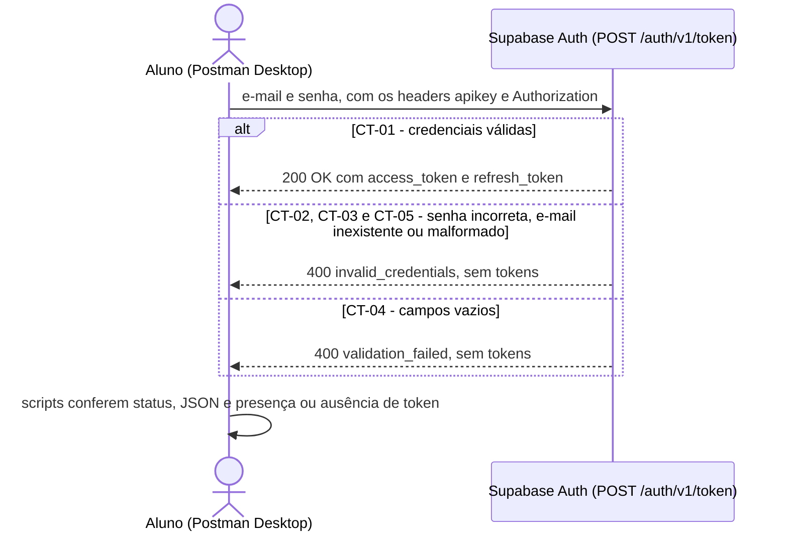
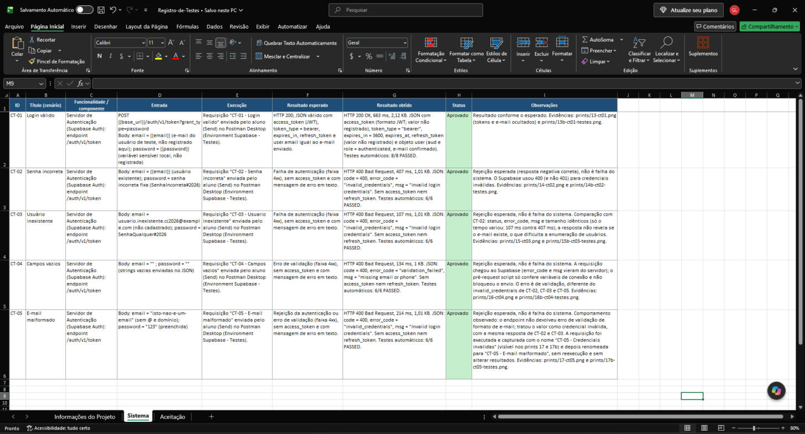
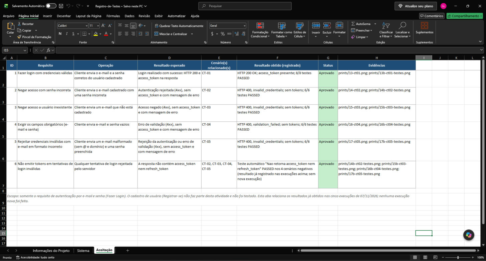
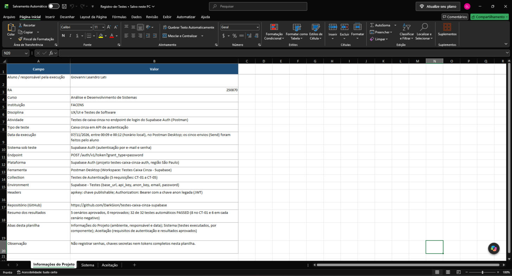
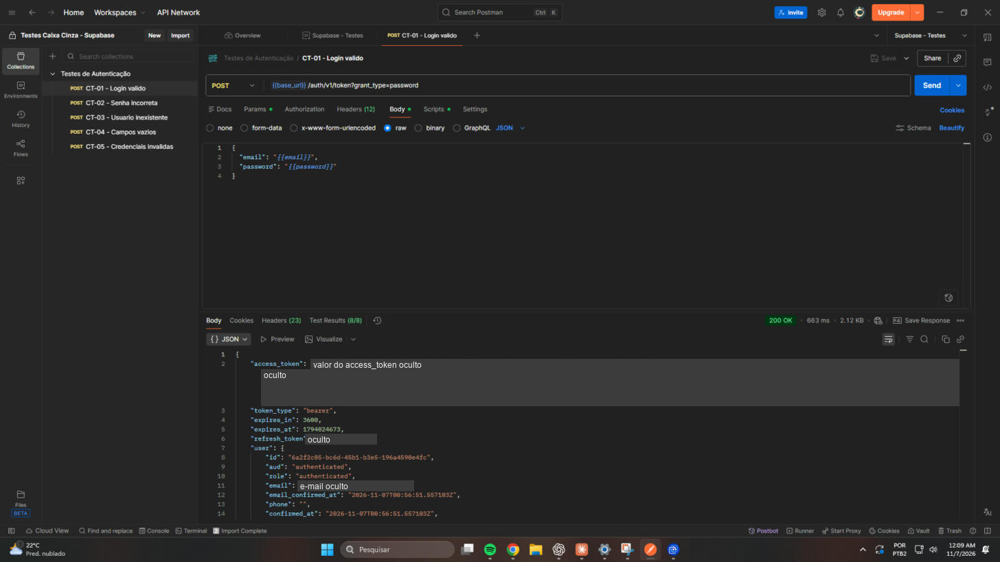
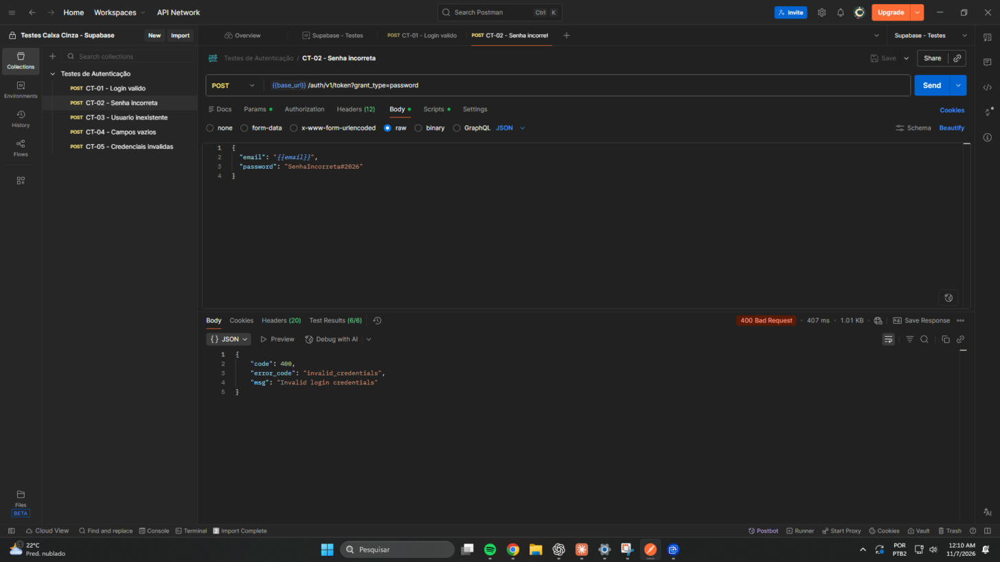
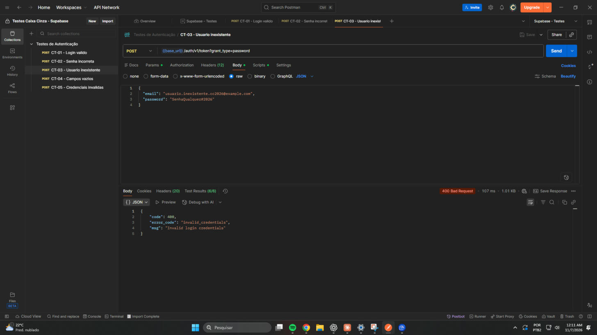
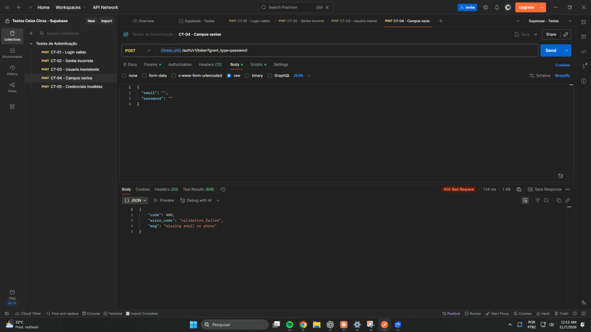
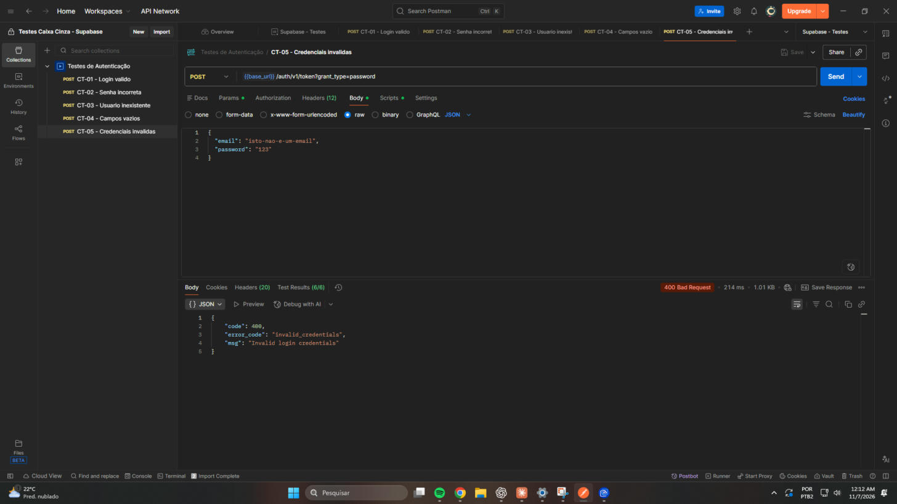

# Testes de Caixa Cinza em API de Autenticação (Supabase + Postman)

> **Status do documento:** os cinco cenários foram **executados pelo aluno** no Postman Desktop em 07/11/2026 e os resultados reais estão nas seções 6 a 9. Resumo: **5 cenários aprovados, 0 reprovados**; 32 de 32 testes automáticos PASSED.

**Aluno:** Giovanni Leandro Lati
**RA:** 250870
**Curso:** Análise e Desenvolvimento de Sistemas
**Instituição:** FACENS
**Disciplina:** UX/UI e Testes de Software
**Atividade:** Testes de caixa cinza no endpoint de login do Supabase Auth (Postman)

---

## 1. Introdução

Este repositório documenta uma atividade individual de **testes de caixa cinza** no endpoint de login por e-mail e senha do **Supabase Auth**, usando o **Postman Desktop**.

No teste de caixa cinza o testador conhece parte da estrutura interna do sistema (aqui, o contrato do endpoint, os headers exigidos, o formato das respostas e o comportamento esperado das chaves de API), mas não acessa o código-fonte do servidor. Esse conhecimento parcial é usado para projetar cenários e escrever verificações automáticas.

## 2. Objetivo da Atividade

Validar o comportamento do endpoint:

```
POST {{base_url}}/auth/v1/token?grant_type=password
```

em cinco cenários: login válido, senha incorreta, usuário inexistente, campos vazios e e-mail malformado, verificando código HTTP, estrutura do JSON, mensagens de erro e a presença (ou ausência) do `access_token`.

## 3. Configuração do Supabase

Tudo abaixo foi feito no painel do Supabase (`supabase.com/dashboard`) com a conta do aluno.

| Item | Configuração realizada |
|---|---|
| Organização | `Faculdade - Testes` (tipo Personal, plano Free), criada para a atividade |
| Projeto | `testes-caixa-cinza-auth`, região **South America (São Paulo)** (`sa-east-1`), plano Free |
| Status do projeto | **Healthy** no painel após a criação |
| Autenticação por e-mail e senha | Provedor **Email** habilitado (já vem ativo por padrão); **Confirm email** ligado |
| Usuário de teste | Criado pelo próprio aluno em Authentication → Users → Add user, com confirmação automática (campo **Confirmed** preenchido; **Last signed in** vazio antes dos testes) |
| Project URL | `https://rnnotajqeieoufoeowir.supabase.co` |
| Chaves públicas | Chave **publishable** (`sb_publishable_…`) e chave legada **anon** (JWT, `role: anon`), ambas em Settings → API Keys |

A chave secreta (`sb_secret_…`) e a `service_role` **não são usadas** em nenhuma requisição. A senha do banco de dados foi gerada pelo Supabase e não foi registrada em nenhum lugar, pois a atividade não usa o banco diretamente.

### Decisão sobre os headers `apikey` e `Authorization`

A documentação oficial do Supabase (guia de API keys) orienta: _enviar as chaves publishable e secret no header `apikey`, e não em `Authorization: Bearer`_, porque a chave publishable **não é um JWT**. O professor exige o header `Authorization`. Para atender às duas coisas sem usar chave administrativa:

| Header | Valor | Motivo |
|---|---|---|
| `apikey` | `{{api_key}}` (chave publishable) | Uso documentado da chave publishable |
| `Authorization` | `Bearer {{anon_key}}` (chave `anon` legada, em formato JWT) | A `anon` é um JWT público; atende à exigência do professor |

A documentação descreve a `anon` como a versão legada da chave publishable, válida enquanto não for desativada no painel, e informa que as chaves legadas (`anon`/`service_role`) serão descontinuadas (o painel menciona o início de 2027). Ela **não** trata do uso da `anon` em `Authorization` com a publishable em `apikey`; por isso a combinação foi verificada na prática.

### Verificação de compatibilidade com `/auth/v1/token`

Foram feitas sondagens com `curl` usando um e-mail descartável (`.invalid`). **Elas não são um dos cinco cenários e não contam como resultado de teste.**

| Combinação de headers | Resposta observada |
|---|---|
| `apikey` publishable + `Authorization: Bearer <anon JWT>` (**adotada**) | HTTP 400, `invalid_credentials` |
| `apikey` anon + `Authorization: Bearer <anon JWT>` | HTTP 400, `invalid_credentials` |
| `apikey` publishable + `Authorization: Bearer <publishable>` (contraria a doc) | HTTP 400, `invalid_credentials` |
| Somente `apikey` publishable | HTTP 400, `invalid_credentials` |
| Sem `apikey` | HTTP 401, "No API key found in request" |

Conclusão: o endpoint aceita a combinação adotada (o 400 vem da verificação de credenciais, não de rejeição de chave). Observação: todas as combinações com chave foram aceitas, então esta sondagem **não** mostra diferença de comportamento entre elas; a escolha segue a documentação.

**Evidências:** `prints/01-supabase-projeto-healthy.jpg`, `prints/02-supabase-auth-email-habilitado.jpg`, `prints/03-supabase-chave-publishable.jpg`, `prints/09-supabase-anon-legada-service-role-mascarada.jpg`, `prints/11-supabase-usuario-lista-email-oculto.jpg` (usuário de teste, provedor E-mail, criado em 06/11/2026, **Último login vazio**) e `prints/12-supabase-usuario-confirmado-email-oculto.jpg` (detalhe do usuário com **Confirmado** preenchido).

No print 03 o valor da chave publishable foi **coberto com uma tarja** antes da publicação (o prefixo `sb_publishable_` continua visível); no print 09 a chave `anon` aparece truncada e a `service_role` mascarada.

Nos prints 11 e 12 o e-mail pessoal foi **coberto com uma tarja** na imagem (edição feita só na captura, não no Supabase). A tela está em português porque o Chrome traduziu a página automaticamente. O rodapé "Total: 10 usuários (estimado)" é uma estimativa do painel; a lista mostra apenas o usuário de teste. No print 12, um aviso do painel ("Explorador e Cadernos") cobre o valor de "Último login feito"; o valor vazio de "Último login" aparece no print 11.

## 4. Configuração do Postman

| Item | Configuração realizada |
|---|---|
| Conta | Postman Desktop autenticado na conta do aluno |
| Workspace | `Testes Caixa Cinza - Supabase` (tipo Internal, acesso "Only you and invited people") |
| Environment | `Supabase - Testes`, selecionado como ambiente ativo |
| Collection | `Testes de Autenticação`, com 5 requisições |

Variáveis do Environment `Supabase - Testes`:

| Variável | Conteúdo | Tipo |
|---|---|---|
| `base_url` | Project URL do Supabase | padrão |
| `api_key` | Chave publishable | **sensível** (mascarada) |
| `anon_key` | Chave `anon` legada (JWT) | **sensível** (mascarada) |
| `email` | E-mail do usuário de teste | **sensível** (mascarado) |
| `password` | Senha do usuário de teste | **sensível**, preenchida só localmente pelo aluno |

Os valores ficam **locais** ao Postman Desktop (comportamento padrão do Postman). Nenhum valor secreto está neste repositório: `postman/Supabase-Testes.postman_environment.template.json` contém apenas marcadores.

A collection foi gerada como arquivo JSON (`postman/Testes-de-Autenticacao.postman_collection.json`) e **importada** no Postman pelo menu Import (uma primeira versão foi descartada e reimportada após a revisão dos headers); URL, headers, body e scripts foram conferidos na interface depois da importação.

A identificação do aluno (nome, RA, curso e instituição) consta na **descrição da Collection** `Testes de Autenticação`.

**Evidências:** `prints/04-postman-environment-variaveis.jpg`, `prints/05-postman-workspace-collection-endpoint-headers.jpg`, `prints/10-postman-identificacao-aluno.jpg` (identificação do aluno na Collection, com Workspace e Environment ativo visíveis).

## 5. Configuração das Requisições

Todas as requisições usam:

- **Método e URL:** `POST {{base_url}}/auth/v1/token?grant_type=password`
- **Headers:**
  - `apikey: {{api_key}}`
  - `Authorization: Bearer {{anon_key}}`
  - `Content-Type: application/json`
- **Body (raw/JSON):** conforme a tabela.

### Exemplo dos headers

| Header | Valor usado na requisição | Exemplo ilustrativo (fictício) | Função |
|---|---|---|---|
| `apikey` | `{{api_key}}` | `sb_publishable_<CHAVE_FICTICIA>` | Chave **publishable** do projeto, enviada em `apikey`, como orienta a documentação do Supabase |
| `Authorization` | `Bearer {{anon_key}}` | `Bearer <JWT_ANON_EXEMPLO_FICTICIO>` | Chave **anon legada**, que é um JWT, enviada como Bearer para atender à exigência do professor |
| `Content-Type` | `application/json` | `application/json` | Indica que o corpo da requisição é JSON |

A chave publishable **não é um JWT**, por isso ela vai em `apikey` e não em `Authorization: Bearer`. A chave `anon` legada é um JWT e, por isso, pôde ser usada no header `Authorization` sem recorrer a nenhuma chave administrativa (`sb_secret_…` e `service_role` não são usadas). A justificativa completa e a verificação com `curl` estão na seção 3 ("Decisão sobre os headers"). Os valores da coluna "Exemplo ilustrativo" são inventados e só mostram o formato; nas requisições reais as chaves vêm das variáveis do Environment e **não** aparecem neste repositório.

### Exemplo do body

Formato do corpo enviado (valores **fictícios**, só para ilustrar):

```json
{
  "email": "usuario.teste@example.com",
  "password": "SenhaFicticia#123"
}
```

Nos testes reais o CT-01 usa `{{email}}` e `{{password}}`, lidos do Environment local, e os demais cenários usam os corpos da tabela abaixo.

### Fluxo de login testado

Diagrama complementar, no estilo dos diagramas de sequência vistos em aula. Ele descreve somente o que foi **observado** nas execuções reais deste repositório.



### Requisições

| ID | Cenário | Nome da requisição no Postman | Body enviado |
|---|---|---|---|
| CT-01 | Login válido | `CT-01 - Login valido` | `email = {{email}}`, `password = {{password}}` (usuário existente, credenciais válidas) |
| CT-02 | Senha incorreta | `CT-02 - Senha incorreta` | `email = {{email}}` (usuário existente), `password = "SenhaIncorreta#2026"` (fixa, diferente da senha real) |
| CT-03 | Usuário inexistente | `CT-03 - Usuario inexistente` | `email = "usuario.inexistente.cc2026@example.com"` (não cadastrado), `password = "SenhaQualquer#2026"` |
| CT-04 | Campos vazios | `CT-04 - Campos vazios` | `email = ""`, `password = ""` (strings vazias enviadas no JSON, sem variáveis) |
| CT-05 | E-mail malformado | `CT-05 - E-mail malformado` | `email = "isto-nao-e-um-email"`, `password = "123"` (senha preenchida) |

Os nomes do Postman não levam acento; no restante do documento os cenários aparecem com a grafia normal.

**CT-05 e o requisito de "credenciais inválidas".** O enunciado da atividade pede, como quinto cenário, um teste de **credenciais inválidas**. Esse requisito foi implementado como `CT-05 - E-mail malformado`: as credenciais enviadas são inválidas porque o e-mail tem **formato incorreto** (`isto-nao-e-um-email`, sem `@` e sem domínio), acompanhado de uma senha preenchida (`123`). Ele se diferencia do CT-02 (senha errada para um usuário existente) e do CT-03 (e-mail bem formado, mas não cadastrado), e por isso cobre uma terceira forma de credencial inválida. Na primeira versão da Collection a requisição se chamava "CT-05 - Credenciais invalidas"; o nome foi trocado para descrever com exatidão a entrada testada.

### Isolamento entre cenários

- Os bodies de CT-03, CT-04 e CT-05 não usam `{{email}}` nem `{{password}}`; CT-02 usa apenas `{{email}}`. Assim, uma variável vazia ou alterada não contamina os casos negativos.
- **Nenhum script altera variáveis** (não há `set`/`unset`, `setNextRequest` nem requisições auxiliares), e nenhum token é gravado ou exibido no console.

### Pré-request scripts

- Todos conferem apenas se `base_url`, `api_key` e `anon_key` existem (Environment selecionado). Se faltar algum, a execução é interrompida com mensagem clara.
- CT-01 também exige `email` e `password`; CT-02 exige `email` e confere que a senha real não é igual à senha incorreta fixa.
- CT-03, CT-04 e CT-05 **não dependem** de `email` nem de `password`, portanto não são bloqueados por elas.

### Verificações automáticas (aba Scripts → Post-response)

- **Todas:** tempo de resposta abaixo de 3000 ms, `Content-Type` JSON e corpo JSON válido.
- **CT-01:** status 200 (código de sucesso do endpoint); `access_token` presente, não vazio e com formato de JWT (3 partes); `token_type = bearer`; `expires_in` numérico; `refresh_token` presente; `user.email` igual ao e-mail enviado.
- **CT-02 a CT-05 (negativos):** status na **faixa 4xx** (`400` a `499`); ausência de `access_token` e `refresh_token`; presença de uma mensagem de erro em texto (em `msg`, `message`, `error_description` ou `error`). **Os scripts não presumem um código HTTP, `error_code` ou texto específicos**: esses valores devem ser lidos da resposta real e registrados.

**Evidências:** `prints/05-postman-workspace-collection-endpoint-headers.jpg` (workspace, collection, environment ativo, endpoint e headers), `prints/06-postman-ct01-body.jpg`, `prints/07-postman-ct01-scripts-testes.jpg`, `prints/08-postman-ct04-campos-vazios-body.jpg`.

## 6. Execução dos Testes

Os cinco cenários foram executados em **07/11/2026, entre 00:09 e 00:12 (horário local)**, no Postman Desktop, com o Workspace `Testes Caixa Cinza - Supabase` e o Environment `Supabase - Testes` ativos.

Procedimento aplicado a cada cenário, um de cada vez:

1. A requisição foi aberta e preparada (URL, headers e body conferidos).
2. **O aluno clicou pessoalmente em Send.** O assistente não enviou nenhuma requisição.
3. A resposta (status HTTP, tempo, JSON) e a aba **Test Results** foram lidas e capturadas direto do Postman.
4. Só então se passou ao cenário seguinte.

Nas capturas do CT-01, os valores de `access_token` e `refresh_token` e o e-mail do usuário foram cobertos com tarja; os nomes dos campos continuam visíveis. As tarjas foram aplicadas apenas sobre a imagem. Códigos HTTP, mensagens de erro e resultados dos testes não foram alterados.

## 7. Registro dos Testes

Registro completo na planilha `planilha/Registro-de-Testes.xlsx`, organizada em três abas, no modelo de registro visto em aula:

- **Informações do Projeto:** ambiente, responsável e data dos testes.
- **Sistema:** os testes executados, por componente (entrada, execução, esperado, obtido, status e observações técnicas de cada caso).
- **Aceitação:** os requisitos de autenticação relacionados aos cenários e aos resultados aprovados (sem nenhuma execução nova).

| ID | Cenário | Entrada utilizada | Resultado esperado | Resultado obtido | Status |
|---|---|---|---|---|---|
| CT-01 | Login válido | `email = {{email}}` (e-mail do usuário de teste), `password = {{password}}` (senha local, não registrada) | HTTP 200 com `access_token` | HTTP **200 OK**, `access_token` presente, `token_type = bearer`, `expires_in = 3600` | Aprovado |
| CT-02 | Senha incorreta | `email = {{email}}` (usuário existente), `password = "SenhaIncorreta#2026"` | Falha de autenticação (4xx), sem `access_token` | HTTP **400**, `invalid_credentials`, "Invalid login credentials" | Aprovado |
| CT-03 | Usuário inexistente | `email = "usuario.inexistente.cc2026@example.com"` (não cadastrado), `password = "SenhaQualquer#2026"` | Falha de autenticação (4xx), sem `access_token` | HTTP **400**, `invalid_credentials`, "Invalid login credentials" | Aprovado |
| CT-04 | Campos vazios | `email = ""`, `password = ""` | Erro de validação (4xx), sem `access_token` | HTTP **400**, `validation_failed`, "missing email or phone" | Aprovado |
| CT-05 | E-mail malformado | `email = "isto-nao-e-um-email"`, `password = "123"` | Rejeição ou erro de validação (4xx), sem `access_token` | HTTP **400**, `invalid_credentials`, "Invalid login credentials" | Aprovado |

"Aprovado" significa que o resultado observado correspondeu ao esperado. Nos casos CT-02 a CT-05 a resposta negativa **é o comportamento correto** do sistema; nenhuma delas indica falha do Supabase.

O CT-05 (`CT-05 - E-mail malformado`) representa o requisito de **credenciais inválidas** do enunciado, por meio de um e-mail em formato incorreto (veja a seção 5).

**Planilha de testes preenchida** (capturas reais do arquivo `planilha/Registro-de-Testes.xlsx` aberto no Excel):

| Aba | Conteúdo | Captura |
|---|---|---|
| Sistema | Os cinco cenários, as entradas, os resultados obtidos e os status | [prints/18-planilha-testes-preenchida.png](prints/18-planilha-testes-preenchida.png) |
| Aceitação | Requisitos de autenticação relacionados aos cenários e aos resultados aprovados | [prints/18b-planilha-aceitacao.png](prints/18b-planilha-aceitacao.png) |
| Informações do Projeto | Ambiente, responsável e data dos testes | [prints/18c-planilha-informacoes-projeto.png](prints/18c-planilha-informacoes-projeto.png) |





## 8. Resultados Obtidos

Valores lidos diretamente do Postman:

| ID | Status HTTP | Tempo | Tamanho | Corpo da resposta (campos relevantes) | Testes automáticos |
|---|---|---|---|---|---|
| CT-01 | 200 OK | 663 ms | 2,12 KB | `access_token` (JWT, oculto), `token_type: "bearer"`, `expires_in: 3600`, `expires_at`, `refresh_token` (oculto), `user` (`aud` e `role`: `authenticated`, e-mail confirmado) | 8/8 PASSED |
| CT-02 | 400 Bad Request | 407 ms | 1,01 KB | `code: 400`, `error_code: "invalid_credentials"`, `msg: "Invalid login credentials"` | 6/6 PASSED |
| CT-03 | 400 Bad Request | 107 ms | 1,01 KB | `code: 400`, `error_code: "invalid_credentials"`, `msg: "Invalid login credentials"` | 6/6 PASSED |
| CT-04 | 400 Bad Request | 134 ms | 1 KB | `code: 400`, `error_code: "validation_failed"`, `msg: "missing email or phone"` | 6/6 PASSED |
| CT-05 | 400 Bad Request | 214 ms | 1,01 KB | `code: 400`, `error_code: "invalid_credentials"`, `msg: "Invalid login credentials"` | 6/6 PASSED |

**Placar:** 5 cenários aprovados, 0 reprovados; 32 de 32 testes automáticos PASSED (8 no CT-01 e 6 em cada negativo).

**Observações sobre o comportamento:**

- **CT-02 × CT-03:** as respostas têm o mesmo status, `error_code`, `msg` e tamanho; só o tempo variou (407 ms e 107 ms), o que, com uma única amostra de cada, não permite concluir nada sobre o servidor. Como o conteúdo é idêntico, a resposta **não revela se o e-mail existe**, o que dificulta a enumeração de usuários.
- **CT-04:** a requisição realmente chegou ao Supabase: `error_code` e `msg` vieram do servidor, e o pré-request script só confere variáveis de conexão. O erro é de **validação** (`validation_failed`), diferente do erro de credenciais dos outros negativos: isso indica que o servidor valida a presença dos campos antes de verificar usuário e senha (inferência a partir da resposta; o código-fonte do servidor não foi consultado).
- **CT-05:** o endpoint **não** devolveu erro de validação de formato de e-mail; tratou o valor malformado como credencial inválida, com a mesma resposta de CT-02 e CT-03.
- **Código HTTP:** para credenciais inválidas o Supabase respondeu **400**, e não 401. Foi o comportamento observado, sem presumir outros códigos.
- **Comportamento inesperado:** nenhum que contrariasse as expectativas definidas. Os itens acima são apenas particularidades observadas.
- **Nome do CT-05:** a requisição foi executada e capturada com o nome "CT-05 - Credenciais invalidas" (visível nos prints 17 e 17b) e **renomeada depois para "CT-05 - E-mail malformado"**, sem reexecutar o teste e sem alterar nenhum resultado. O nome atual, usado na Collection exportada, no README e na planilha, descreve o cenário realmente testado.

**Evidências (Postman Desktop, dados sensíveis ocultados):**

| Cenário | Resposta (status e JSON) | Testes automáticos |
|---|---|---|
| CT-01 | [prints/13-ct01.png](prints/13-ct01.png) | [prints/13b-ct01-testes.png](prints/13b-ct01-testes.png) |
| CT-02 | [prints/14-ct02.png](prints/14-ct02.png) | [prints/14b-ct02-testes.png](prints/14b-ct02-testes.png) |
| CT-03 | [prints/15-ct03.png](prints/15-ct03.png) | [prints/15b-ct03-testes.png](prints/15b-ct03-testes.png) |
| CT-04 | [prints/16-ct04.png](prints/16-ct04.png) | [prints/16b-ct04-testes.png](prints/16b-ct04-testes.png) |
| CT-05 | [prints/17-ct05.png](prints/17-ct05.png) | [prints/17b-ct05-testes.png](prints/17b-ct05-testes.png) |







## 9. Conclusão

**Como a autenticação funciona.** O endpoint `POST /auth/v1/token?grant_type=password` do Supabase Auth recebe e-mail e senha em JSON, junto com a chave pública do projeto no header `apikey`. Se as credenciais conferem, devolve HTTP 200 com um `access_token` em formato JWT, um `refresh_token`, o tipo (`bearer`), a validade (`expires_in`) e os dados do usuário. Se não conferem, devolve um erro em JSON com `code`, `error_code` e `msg`, sem nenhum token.

**Resultados observados.** O login válido (CT-01) retornou 200 com os tokens e a estrutura esperada. Senha incorreta (CT-02), usuário inexistente (CT-03) e e-mail malformado (CT-05) retornaram a mesma resposta 400 `invalid_credentials`; campos vazios (CT-04) retornaram 400 `validation_failed`. Em nenhum caso negativo houve token na resposta. Os cinco cenários corresponderam ao esperado e os 32 testes automáticos passaram. A igualdade entre as respostas de CT-02 e CT-03 é um ponto positivo de segurança, porque não indica a um atacante quais e-mails estão cadastrados.

**Dificuldades encontradas.**
- A chave nova `sb_publishable_…` não é um JWT, enquanto a atividade exige o header `Authorization`. A solução foi usar a publishable em `apikey` e a chave `anon` legada (JWT) em `Authorization: Bearer`; a chave `anon` legada será descontinuada pelo Supabase.
- Foi preciso garantir que variáveis vazias ou pré-request scripts não bloqueassem os casos negativos, e que os testes automáticos não presumissem códigos HTTP que ainda não tinham sido observados.
- Manter senha, chaves e tokens fora das capturas e dos arquivos exigiu variáveis sensíveis no Postman e tarjas nas imagens do CT-01.

**Possíveis melhorias.**
- Testar cenários não cobertos aqui: limite de tentativas (rate limit), senha muito curta ou política de senha, renovação de sessão com o `refresh_token`, token expirado, e-mail ainda não confirmado e injeção de caracteres especiais.
- Rodar a collection com o Collection Runner ou o Newman, de forma automatizada, a cada mudança de configuração do projeto.
- Migrar as chaves legadas para o novo modelo antes da descontinuação e rever os headers.
- Medir o tempo de resposta com várias amostras, e não uma só, antes de tirar conclusões.

**Importância dos testes de caixa cinza.** Conhecer parte do funcionamento interno (o contrato do endpoint, os headers, o formato das respostas e o papel de cada chave) permite projetar cenários mais precisos do que num teste de caixa preta e escrever verificações automáticas objetivas, sem exigir acesso ao código-fonte do servidor, como num teste de caixa branca. Aqui esse conhecimento foi o que permitiu perceber a incompatibilidade entre a chave publishable e o header `Authorization` e distinguir um erro de credenciais de um erro de validação.

---

## Pendências

- Nenhuma pendência de conteúdo: os cinco cenários foram executados e registrados, e o repositório foi publicado depois da auditoria de segurança (sem senhas, tokens ou chaves privadas).
- Fora do escopo desta atividade: cadastro de usuário (Registrar-se), interface gráfica e automação com Selenium.
- O usuário de teste do Supabase é descartável e pode ser excluído após a avaliação.

## Estrutura do repositório

```
README.md
.gitignore
postman/    Collection e template do Environment (sem segredos)
prints/     Evidências reais capturadas (sem segredos)
planilha/   Registro-de-Testes.xlsx
```

## Segurança

Não publicar senhas, chave secreta (`sb_secret_…`), `service_role`, tokens completos de usuário (`access_token`/`refresh_token`) nem a senha do banco. Em capturas de tela de respostas bem-sucedidas, ocultar os tokens.
